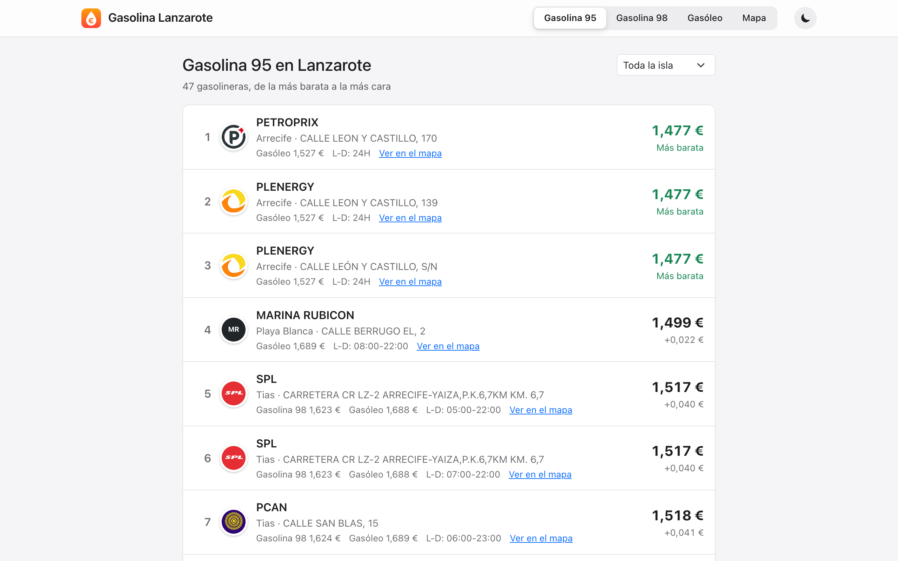
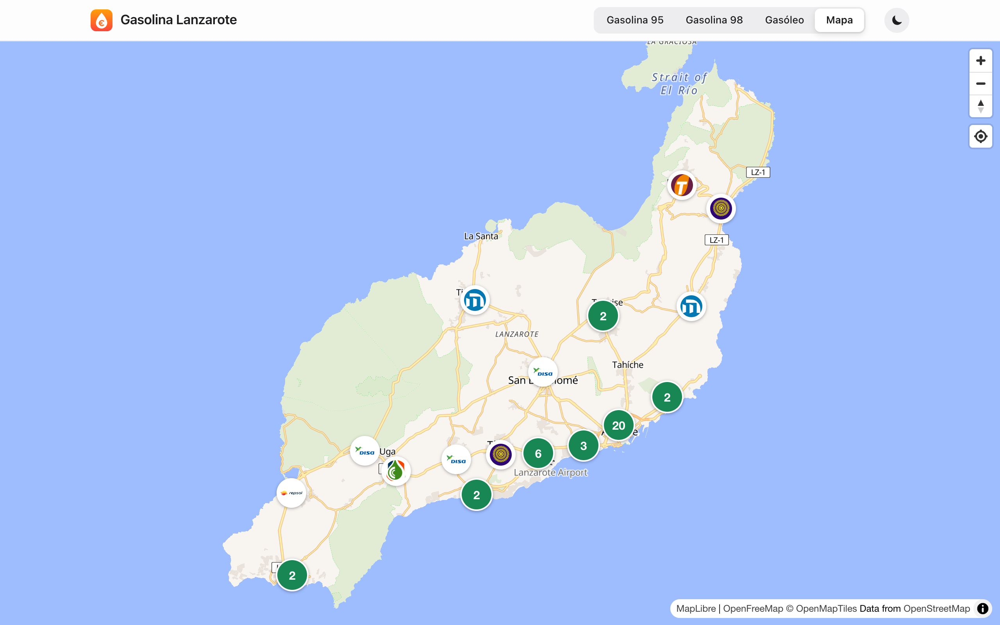
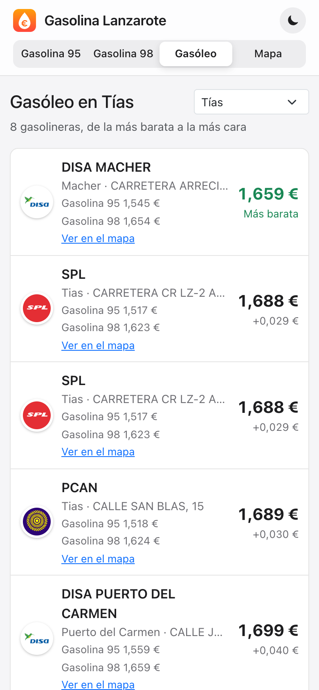
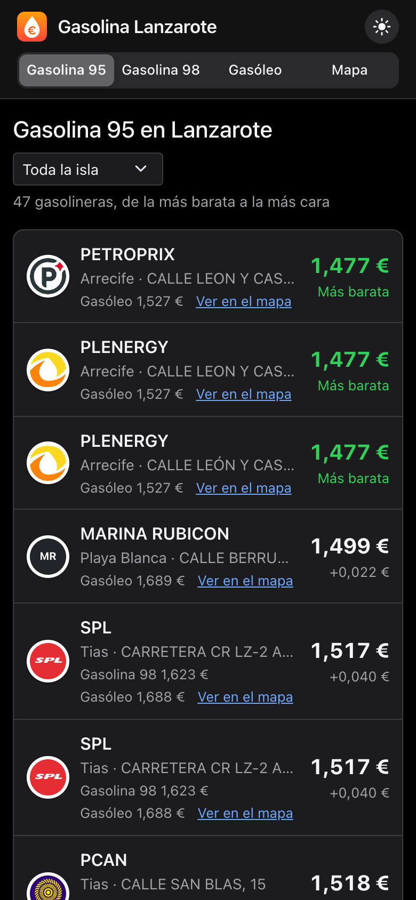

# Precio de la Gasolina en Lanzarote

Web que muestra los precios de la gasolina 95, la gasolina 98 y el gasóleo en las gasolineras de Lanzarote, ordenados de más barato a más caro, y un mapa con todas las estaciones.

**[Ver la web](https://aledeleonez.github.io/appPrecioGasolinaLanzarote/)**



## Qué puedes hacer

- Ver el ranking de las 47 gasolineras de la isla para cada carburante, con la diferencia de precio respecto a la más barata.
- Filtrar por municipio y compartir el enlace ya filtrado (por ejemplo, [gasóleo en Tías](https://aledeleonez.github.io/appPrecioGasolinaLanzarote/gasoleo?municipio=tias)).
- Buscar gasolineras en el mapa y ver sus precios al pulsar en ellas.
- Usarla en el móvil y en modo claro u oscuro.



| Móvil | Modo oscuro |
| :---: | :---: |
|  |  |

## Cómo funciona

Los datos salen de la [API de precios de carburantes](https://sedeaplicaciones.minetur.gob.es/ServiciosRESTCarburantes/PreciosCarburantes/) del Ministerio, que se actualiza cada media hora. Una GitHub Action (`.github/workflows/deploy.yml`) los descarga cada media hora con `scripts/actualizar-datos.ts`, los guarda en un `gasolineras.json` limpio y vuelve a publicar la web, así que el navegador solo descarga ese JSON.

## Tecnologías

React 19, TypeScript, Vite, TanStack Query, React Router, Bootstrap y MapLibre (con mapas de OpenFreeMap). Se publica en GitHub Pages con GitHub Actions.

## Desarrollo

Requiere Node 22.22 o superior.

```sh
npm install
npm run dev       # descarga los datos y arranca el servidor de desarrollo
npm run datos     # solo actualiza public/data/gasolineras.json
npm test          # tests con Vitest
npm run lint      # oxlint
npm run build     # compila en dist/
```

Cada push a `main` se publica solo. Para forzar un despliegue, lanza el workflow **Deploy** a mano desde la pestaña Actions.
